<div align="center">


# 💊 PharmaVictoria

**Sistema de gestión integral para farmacias**
Aplicación de escritorio para controlar ventas, inventario, clientes, proveedores y reportes.


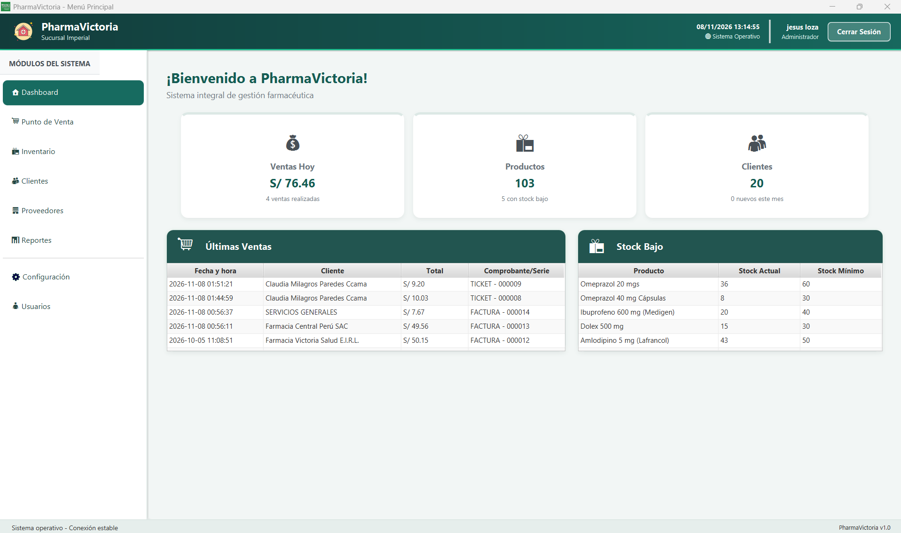

</div>

---

## 📑 Tabla de contenido

1. [Descripción](#-descripción)
2. [Características principales](#-características-principales)
3. [Capturas de pantalla](#-capturas-de-pantalla)
4. [Módulos](#-módulos)
5. [Roles y permisos](#-roles-y-permisos)
6. [Arquitectura](#-arquitectura)
7. [Tecnologías](#-tecnologías)
8. [Estructura del proyecto](#-estructura-del-proyecto)
9. [Instalación y ejecución](#-instalación-y-ejecución)
10. [Configuración](#-configuración)
11. [Base de datos](#-base-de-datos)
12. [Documentación](#-documentación)
13. [Hoja de ruta](#-hoja-de-ruta)
14. [Equipo](#-equipo)
15. [Licencia](#-licencia)

---

## 📖 Descripción

**PharmaVictoria** es una aplicación de escritorio desarrollada en **Java con JavaFX** y **MySQL**, pensada para la gestión diaria de una farmacia local: registrar ventas, controlar el stock y los vencimientos, administrar clientes y proveedores, emitir comprobantes y generar reportes.

El proyecto nace del caso real de la farmacia **PharmaVictoria** (distrito de Imperial, provincia de Cañete, Perú), que cuenta con dos sucursales y un equipo reducido por sede. Además, es el trabajo de investigación del curso de **Arquitectura de Software** de la **Universidad Nacional de Cañete (UNCAÑETE)**, donde se aplican **patrones de diseño GoF** y el **modelo C4** para documentar la arquitectura.

**Objetivos**

- Digitalizar y centralizar las operaciones de la farmacia.
- Mejorar la trazabilidad del inventario y la precisión de la información.
- Mantener una arquitectura modular, segura y escalable.

---

## ✨ Características principales

- 📦 **Inventario** con lotes, fechas de vencimiento, stock mínimo, edición masiva e historial de cambios.
- 🛒 **Punto de venta** con carrito, pagos mixtos y comprobantes (boleta, factura y ticket).
- 🧾 **Facturación electrónica** mediante integración con NubeFacT (descarga de PDF/XML).
- 👥 **Clientes** naturales y empresas, con **puntos canjeables** (hasta el 50 % del total).
- 🚚 **Proveedores** con contacto por correo desde el sistema.
- 📊 **Reportes** de ventas por período, producto y usuario, exportables a **PDF y Excel**.
- 🔐 **Roles y permisos** granulares (Administrador / Vendedor).
- 🕵️ **Auditoría**: historial de cambios y de accesos.
- 💾 **Respaldos y restauración** de la base de datos.
- 🔔 **Alertas** por correo de stock bajo y productos próximos a vencer.

---

## 🖼️ Capturas de pantalla

| Inicio de sesión | Dashboard | Punto de venta |
|:---:|:---:|:---:|
| 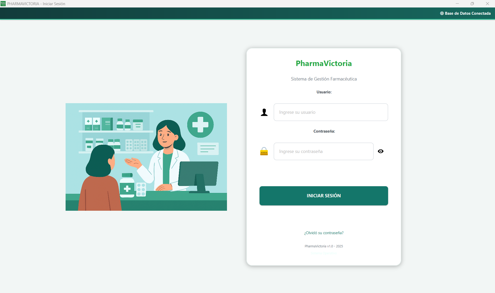 |  | 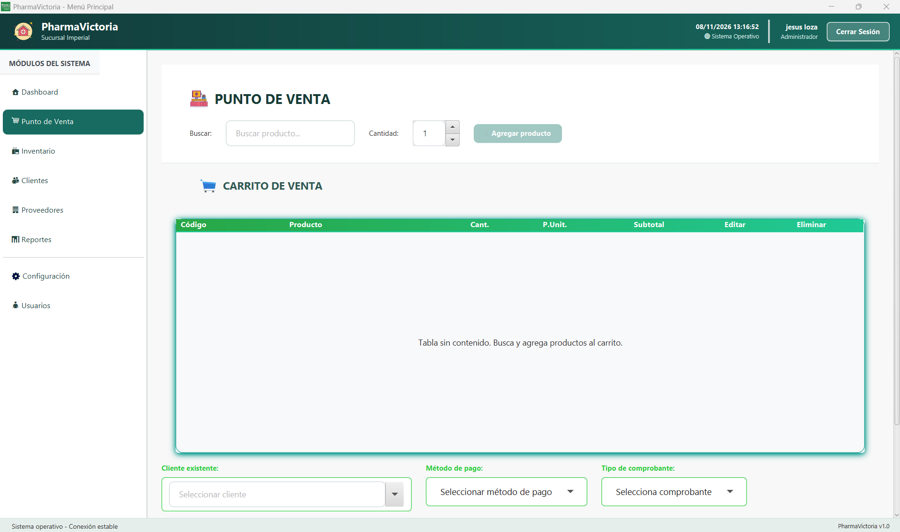 |

| Inventario | Detalle de producto | Clientes |
|:---:|:---:|:---:|
| 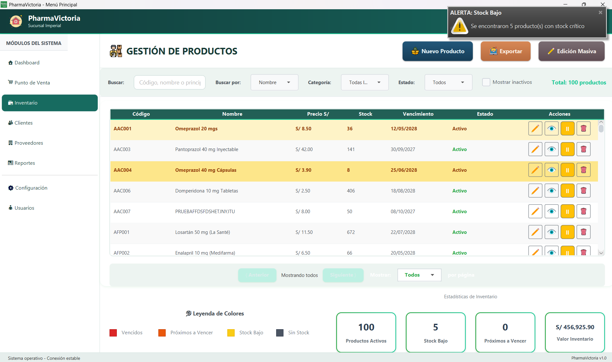 | 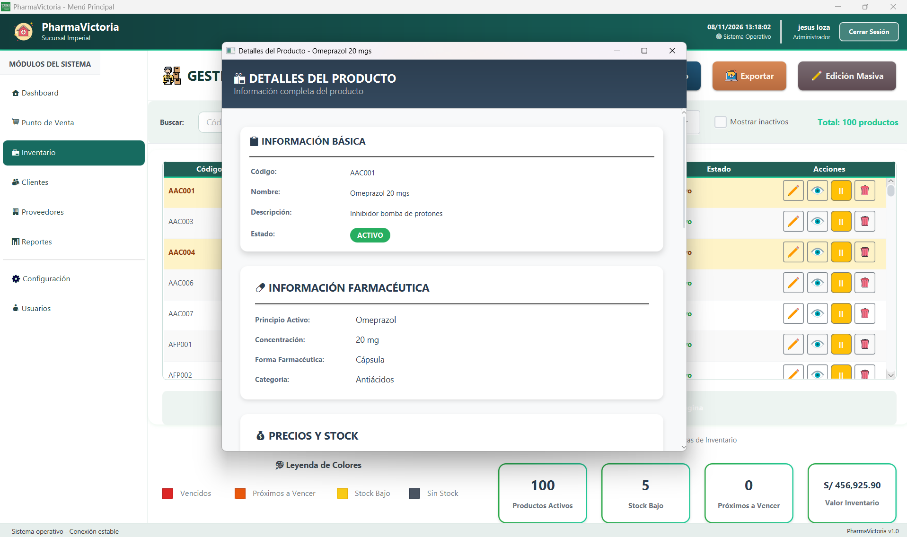 | 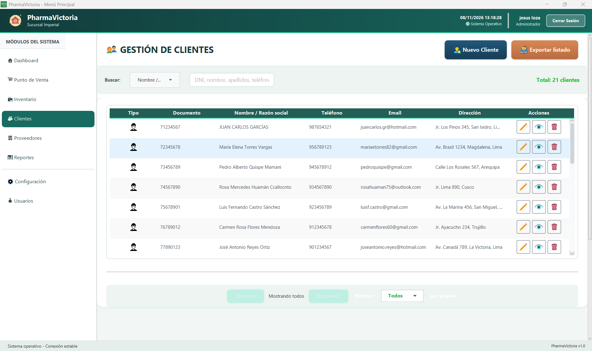 |

| Proveedores | Reportes | Configuración y permisos |
|:---:|:---:|:---:|
| 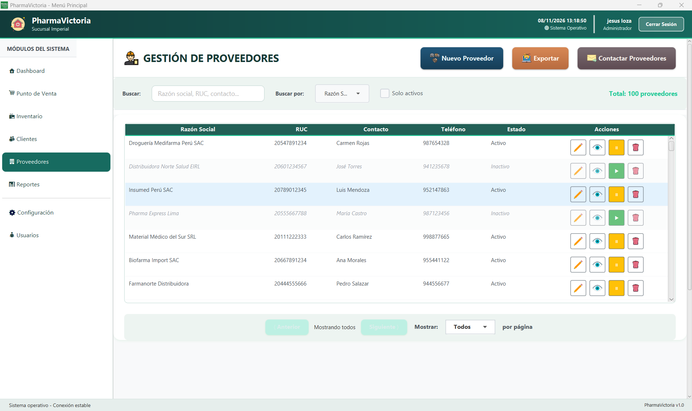 | 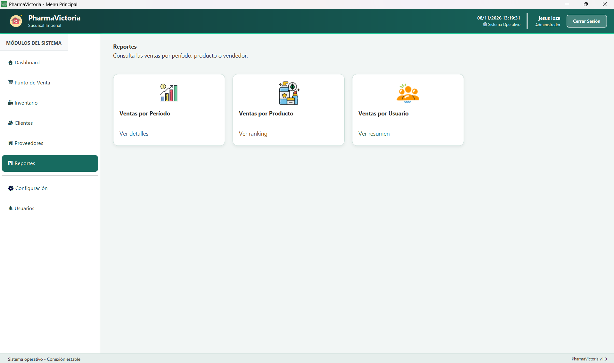 | 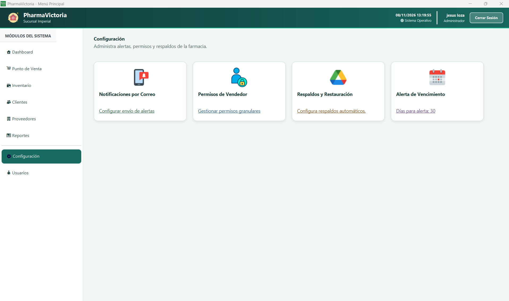 |

> 🎬 **Demo:** 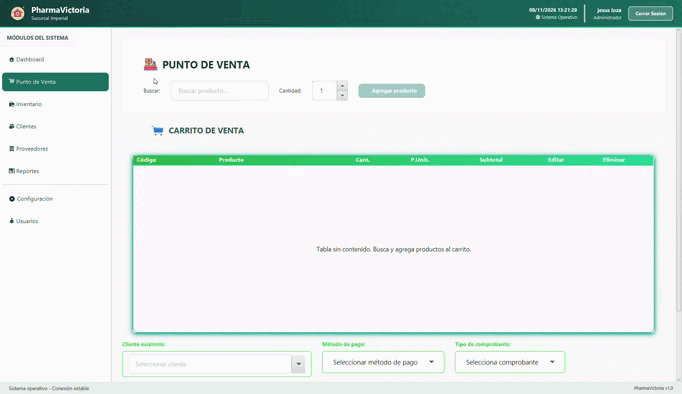

> ⚠️ Las capturas usan **datos ficticios**.

---

## 🧩 Módulos

### 🔑 Login y recuperación de contraseña
Acceso con usuario y contraseña, opción de mostrar u ocultar la clave, estado de la conexión a la base de datos, versión de la app y sistema operativo detectado. Si el usuario olvida su contraseña, recibe un **código por correo (válido 10 minutos)** para restablecerla.

### 🏠 Dashboard
Resumen del día: ventas, cantidad de productos (y cuántos tienen stock bajo) y clientes. El administrador además ve las **últimas ventas** y la tabla de **stock bajo**.

### 📦 Inventario
Alta, edición, activación/inactivación y eliminación de productos. Incluye generación automática de código, cálculo de margen, control de receta y producto controlado, **edición masiva**, filtros y búsqueda, exportación a Excel/PDF, estadísticas y una vista de detalle de solo lectura con **historial de cambios**.

### 🚚 Proveedores
Registro y edición, productos asociados, condiciones de pago, **envío de correos a uno o varios proveedores**, exportación y gráficos (top de proveedores con más productos y distribución por estado).

### 👥 Clientes
Clientes naturales (DNI) y empresas (RUC), historial de cambios, **historial de puntos** y de compras, exportación y gráficos (top 3 clientes con más compras y distribución por rango de edad).

### 🛒 Punto de venta
Búsqueda de productos en tiempo real, validación de stock y vencimiento, cálculo automático de subtotal, IGV y descuento, pagos (efectivo, tarjeta, transferencia o mixto), canje de puntos, confirmación de venta, historial de las últimas 24 h y **anulación de ventas**.

### 📈 Reportes *(administrador)*
- Ventas por período
- Ventas por producto
- Ventas por usuario

Con filtros por fecha y exportación.

### 🧑‍💼 Usuarios *(administrador)*
Alta, edición, activación/inactivación y eliminación de usuarios, con rol **ADMIN** o **VENDEDOR**. Cada usuario tiene historial de accesos (fecha, IP y dispositivo) y auditoría de cambios.

### ⚙️ Configuración *(administrador)*
- Notificaciones por correo
- Permisos del vendedor
- Respaldos y restauración
- Alerta de vencimiento (días de anticipación)

---

## 🛡️ Roles y permisos

| Capacidad | Administrador | Vendedor |
|---|:---:|:---:|
| Dashboard | ✅ completo | ✅ personalizado (sus ventas) |
| Punto de venta | ✅ | ✅ |
| Inventario (consultar y buscar) | ✅ | ✅ |
| Inventario (crear, editar, eliminar, exportar, edición masiva) | ✅ | ⚙️ según permisos |
| Clientes y proveedores (gestión) | ✅ | ⚙️ según permisos |
| Reportes | ✅ | ❌ |
| Usuarios | ✅ | ❌ |
| Configuración, respaldos y permisos | ✅ | ❌ |

⚙️ *El administrador decide qué acciones puede realizar el vendedor en cada módulo.*

---

## 🏗️ Arquitectura

La aplicación sigue una **arquitectura en capas (MVC)** y está documentada con el **modelo C4**.

```
Controladores (JavaFX)  →  Servicios (lógica de negocio)  →  Repositorios  →  MySQL
```

### Diagramas C4

| Nivel | Diagrama |
|---|---|
| 1 · Contexto | 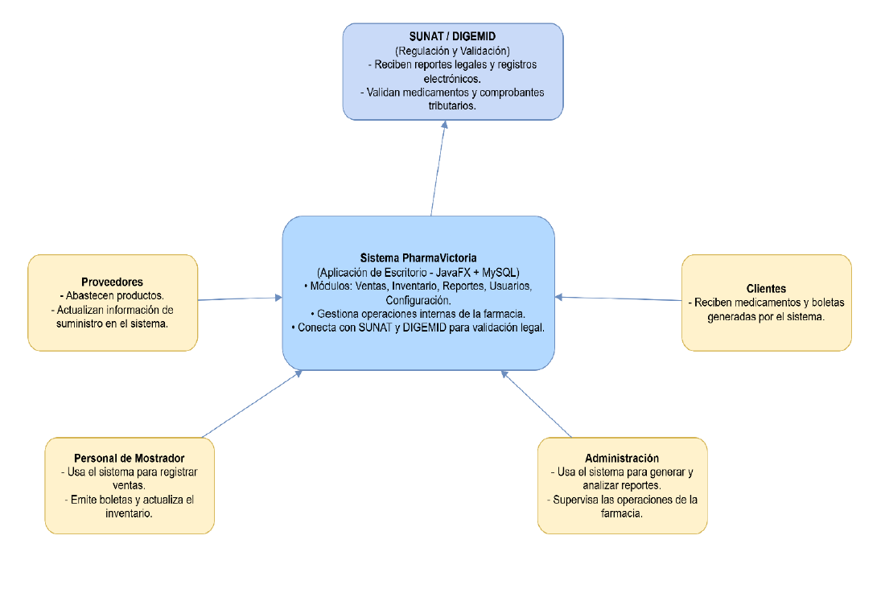 |
| 2 · Contenedores | 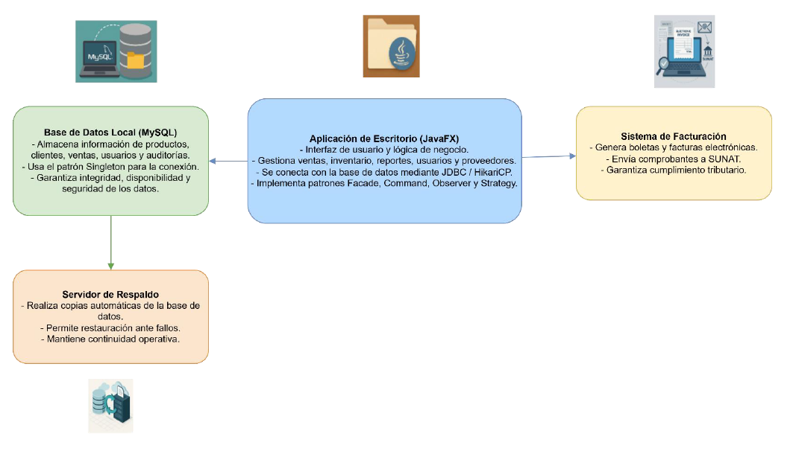 |
| 3 · Componentes | 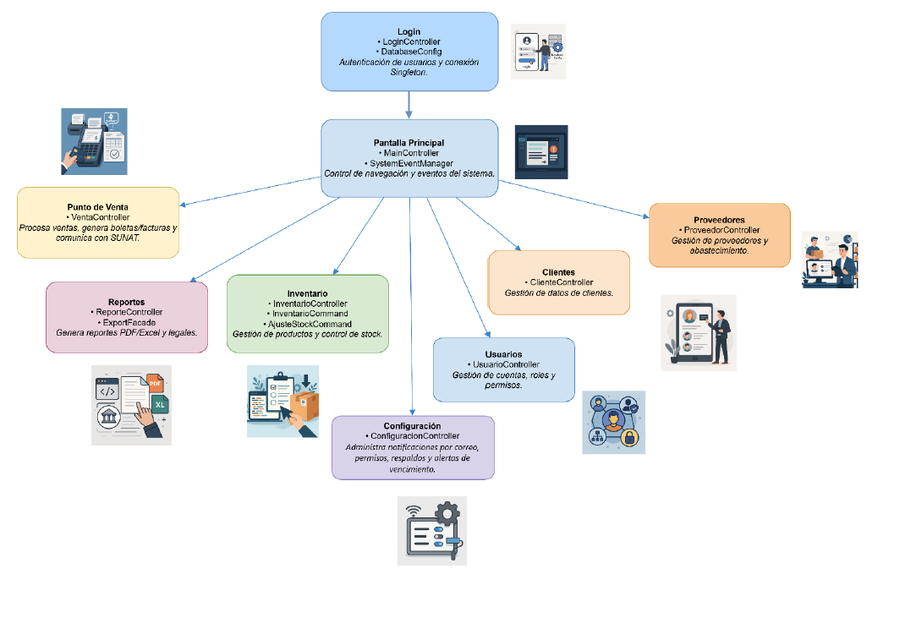 |
| 4 · Código | 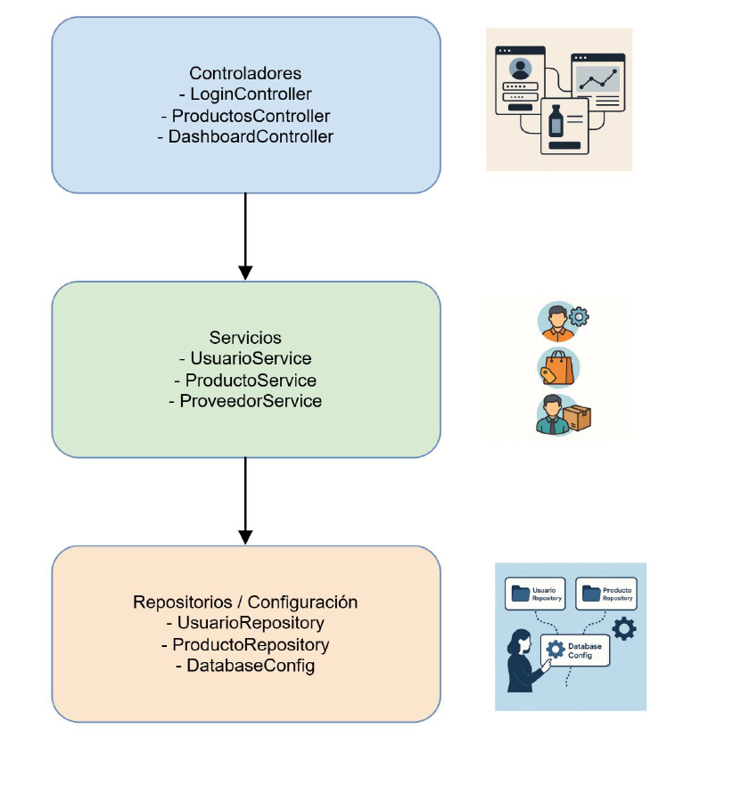 |

### Patrones de diseño (GoF)

| Patrón | Tipo | Clase | Propósito |
|---|---|---|---|
| Singleton | Creacional | `DatabaseConfig` | Una única configuración y pool de conexiones (HikariCP) |
| Factory Method | Creacional | `ComprobanteFactory` | Crear distintos tipos de comprobantes |
| Builder | Creacional | `BoletaBuilder` | Construir boletas paso a paso |
| Facade | Estructural | `ExportFacade` | Interfaz única para exportar a Excel y PDF |
| Command | Comportamiento | `InventarioCommand`, `AjusteStockCommand` | Encapsular operaciones de inventario y registrar auditoría |
| Observer | Comportamiento | `SystemEventManager`, `SystemEventObserver` | Actualizar la interfaz ante eventos del sistema |
| Strategy | Comportamiento | `SearchByVencimientoStrategy` y otras | Búsquedas y filtros intercambiables |

---

## 🛠️ Tecnologías

| Área | Tecnología |
|---|---|
| Lenguaje | Java |
| Interfaz | JavaFX (FXML + CSS) |
| Base de datos | MySQL |
| Pool de conexiones | HikariCP (JDBC) |
| Exportación | Apache POI (Excel), iText (PDF) |
| Facturación electrónica | NubeFacT |
| Gestor de dependencias | Maven / Gradle *(indicar el que uses)* |
| Logging | SLF4J |

---

## 📂 Estructura del proyecto

> Ajusta los nombres a los de tu repositorio real.

```
PharmaVictoria/
├── src/
│   └── main/
│       ├── java/
│       │   └── .../
│       │       ├── controller/     # Controladores JavaFX (Login, Dashboard, Inventario, Venta...)
│       │       ├── service/        # Lógica de negocio (UsuarioService, ProductoService...)
│       │       ├── repository/     # Acceso a datos (UsuarioRepository, ProductoRepository...)
│       │       ├── model/          # Entidades (Usuario, Producto, Cliente, Venta...)
│       │       ├── config/         # DatabaseConfig (Singleton)
│       │       └── patterns/       # Command, Observer, Strategy, Factory, Builder, Facade
│       └── resources/
│           ├── fxml/               # Vistas
│           ├── css/                # Estilos
│           └── images/             # Íconos
├── database/
│   ├── schema.sql                  # Estructura de la base de datos
│   └── sample-data.sql             # Datos ficticios de prueba
├── docs/
│   ├── manuales/                   # Manual del Vendedor y del Administrador (PDF)
│   ├── informe/                    # Informe de Arquitectura de Software (PDF)
│   └── images/                     # Logo, capturas y diagramas C4
├── config.example.properties       # Plantilla de configuración (sin credenciales)
├── .gitignore
├── LICENSE
└── README.md
```

---

## 🚀 Instalación y ejecución

### Requisitos
- JDK 17 o superior *(ajustar a la versión real del proyecto)*
- MySQL 8.x
- Maven o Gradle
- Conexión a internet solo para correo y facturación electrónica

### Pasos

```bash
# 1. Clonar el repositorio
git clone https://github.com/<tu-usuario>/PharmaVictoria.git
cd PharmaVictoria

# 2. Crear la base de datos
mysql -u root -p -e "CREATE DATABASE pharmavictoria CHARACTER SET utf8mb4;"
mysql -u root -p pharmavictoria < database/schema.sql
mysql -u root -p pharmavictoria < database/sample-data.sql   # opcional (datos ficticios)

# 3. Configurar credenciales
cp config.example.properties config.properties
# editar config.properties con tus datos

# 4. Ejecutar
mvn clean javafx:run
```

### Usuario de prueba
| Usuario | Contraseña | Rol |
|---|---|---|
| `admin` | *(definir en sample-data.sql)* | ADMIN |
| `vendedor` | *(definir en sample-data.sql)* | VENDEDOR |

> Cambia estas credenciales antes de usar el sistema en producción.

---

## ⚙️ Configuración

Archivo `config.properties` (**no se sube al repositorio**):

```properties
# Base de datos
db.url=jdbc:mysql://localhost:3306/pharmavictoria
db.user=
db.password=

# Correo (recuperación de contraseña, alertas y contacto con proveedores)
mail.smtp.host=
mail.smtp.port=
mail.user=
mail.password=

# Facturación electrónica (NubeFacT)
nubefact.url=
nubefact.token=
```

Desde el módulo **Configuración** de la app también puedes ajustar notificaciones, permisos del vendedor, respaldos programados y días de alerta de vencimiento.

---

## 🗄️ Base de datos

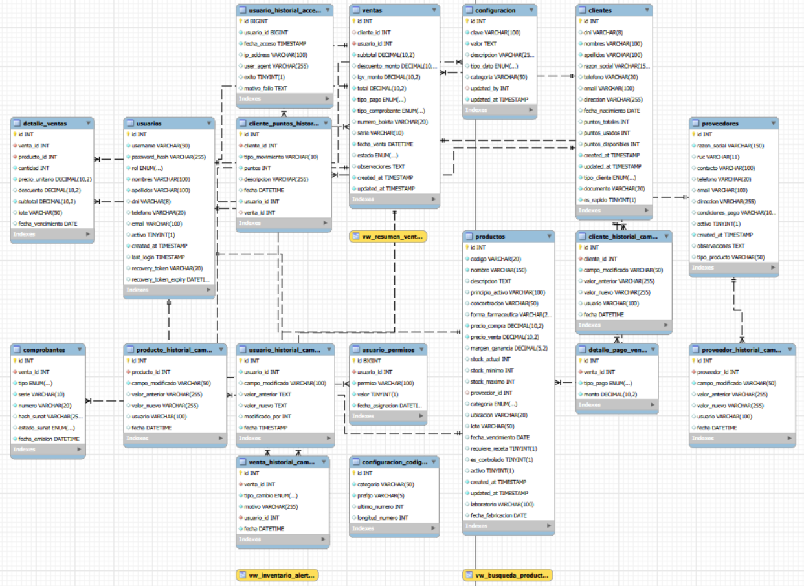

Tablas principales:

| Tabla | Contenido |
|---|---|
| `usuarios` | Cuentas, roles y estado |
| `productos` | Catálogo, lotes, precios, stock y vencimientos |
| `clientes` | Personas naturales y empresas, puntos |
| `proveedores` | Datos y condiciones de pago |
| `ventas` / detalle | Transacciones y comprobantes |
| `audit_log` y tablas de historial | Trazabilidad de cambios y accesos |

---

## 📚 Documentación

- 📘 [Manual de usuario: Vendedor](docs/manuales/ManualUsuario-PharmaVictoria-Vendedor.pdf)
- 📗 [Manual de usuario: Administrador](docs/manuales/ManualUsuario-PharmaVictoria-Administrador.pdf)
- 📙 [Informe de Arquitectura de Software](docs/informe/ProyectoFinalArquitectura.pdf)

---

## 🗺️ Hoja de ruta

- [x] Módulos de login, inventario, clientes, proveedores, ventas, reportes, usuarios y configuración
- [x] Exportación a PDF y Excel
- [x] Auditoría y respaldos
- [ ] Sincronización entre sucursales
- [ ] Integración con DIGEMID para validación de medicamentos
- [ ] Función de "deshacer" en el patrón Command
- [ ] Borrado lógico (en lugar de eliminación permanente)
- [ ] Pruebas automatizadas (unitarias y funcionales)
- [ ] Diagrama de despliegue y de secuencia (venta → inventario → NubeFacT)

---

## 👨‍💻 Equipo

**Universidad Nacional de Cañete · Facultad de Ingeniería · Escuela Profesional de Ingeniería de Sistemas**
Curso: Arquitectura de Software · Docente: Luis Enrique Ramirez Pacheco

| Integrante |
|---|
| Esteban Ricardo Puma Palomino |
| Jesús Ángel Loza Yataco |
| Jean Paul Barrientos Atocsa |
| Augusto Salvador Solano Ayaucán |
| Oliver Francisco Agüela Palomino |

San Vicente de Cañete, Perú · 2025

---

## 📄 Licencia

Distribuido bajo la licencia **MIT**. Consulta el archivo [`LICENSE`](LICENSE) para más información.
